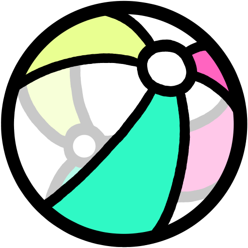

<p align="center">
  
</p>

<h1 align="center">Beachday</h1>

<p align="center">A desktop music player for your own files, built around playlists you can pass on to a friend.</p>

Beachday plays local audio files, but the real point is the `.bday` playlist. It carries everything
you've done to a playlist: names, art, colours, volume, groups. Bundle the music inside and you have
one file you can hand to someone else, on another computer or another operating system, and it opens
looking just the way you made it.

## Features

- **Portable playlists:** save a `.bday` with the music inside it, or without. If someone opens one
  without its music, Beachday helps them find their own copies.
- **Curate without touching your files:** rename and retag tracks, one at a time or in batches, set
  custom art, adjust volume per track, and arrange tracks into groups. It all lives in the playlist, so your music's tags are never changed.
- **A colour theme for every playlist:** pick three colours, start from a preset, or get suggestions
  from the cover art. Beachday keeps the text readable whatever you choose.
- **Big art:** a resizable art pane with animated GIF support, and a generated symbol for any track
  without art.
- **Lyrics:** synced lyrics that follow the song, on their own or laid over the art. They can come
  from [LRCLIB](https://lrclib.net) (optional, and off until you turn it on), or you can paste your own.
- **Playback your way:** shuffle, repeat, stop after the current track, and links that keep tracks
  together in order, even on shuffle.
- **Comfortable with big playlists:** grouped lists that scroll smoothly through thousands of tracks,
  tabs for several playlists at once, and undo for every edit.

Plays MP3, FLAC, WAV, OGG, Opus, M4A and AAC.

## Getting Beachday

Download the latest version from the [Releases page](../../releases/latest). There's no installer,
just something to unpack or run.

### Windows

1. Download `Beachday-<version>-win.zip`.
2. **Before extracting:** right-click the zip, choose **Properties**, tick **Unblock**, and click **OK**.
3. Extract it wherever you like, and run **Beachday.exe** from the folder.

If you skip the Unblock step, Windows says "Windows protected your PC". That's normal for software
made by one person: click **More info**, then **Run anyway**.

### Linux

1. Download `Beachday-<version>.AppImage`.
2. Allow it to run: **Properties ▸ Permissions**, or `chmod +x` on the file.
3. Double-click it.

Having trouble, or want to update or remove Beachday? See [INSTALL.md](INSTALL.md).

## Sharing a playlist

Use **File ▸ Export Bundled Copy…** to make one `.bday` with the music inside, then send that file.
Your names, tags, art, colours, gain, groups and links all go with it.

A playlist saved without its music only works for someone who has the same tracks. Beachday will
help them find their copies.

Lyrics fetched from the internet aren't included; their copy of Beachday can fetch its own. Lyrics
you've pasted or edited are part of the playlist, and do go with it.

To open a playlist you've been sent, use **File ▸ Open Playlist…** in Beachday. Double-clicking a
`.bday` file doesn't open it yet.

## Software

| | |
|---|---|
| **Runs on** | Windows and Linux (64-bit) |
| **Built with** | Electron, React and Vite, in plain JavaScript |
| **Lyrics** | [LRCLIB](https://lrclib.net), a free community lyrics service |
| **License** | [MIT](LICENSE) |

### Running from source

You'll need [Node.js](https://nodejs.org) (Beachday is developed on version 24).

```bash
npm install
npm run dev        # run the app, with hot reload
npm run pack:all   # build the Windows zip and Linux AppImage into release/
```
